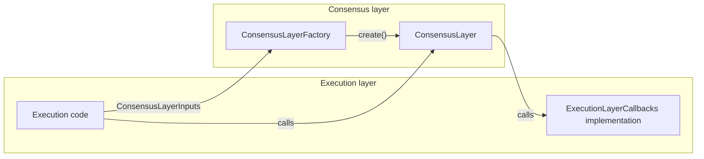
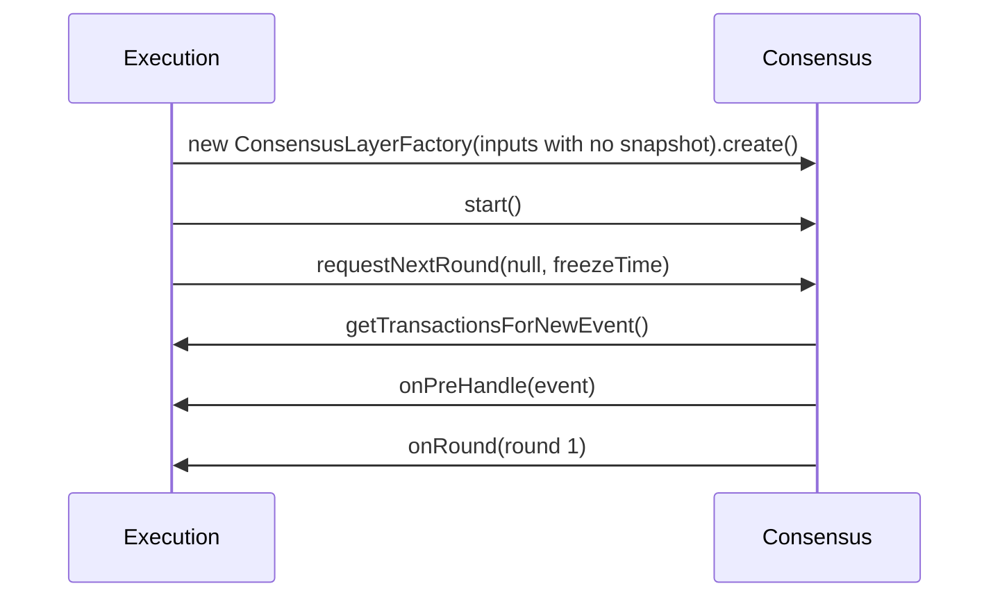
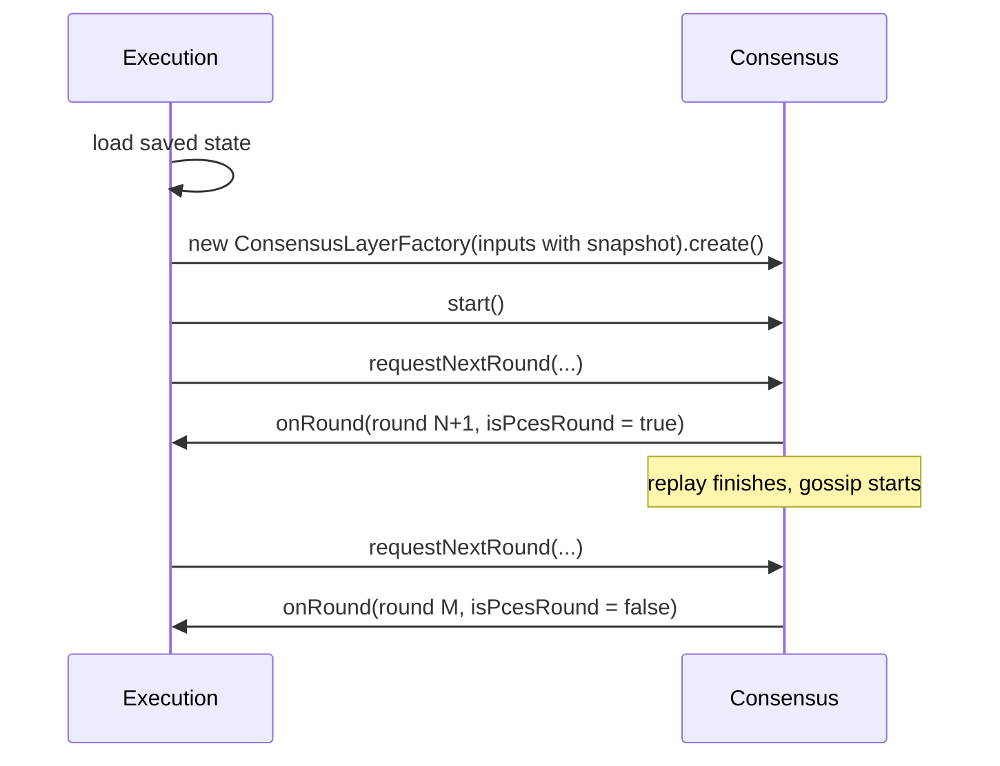
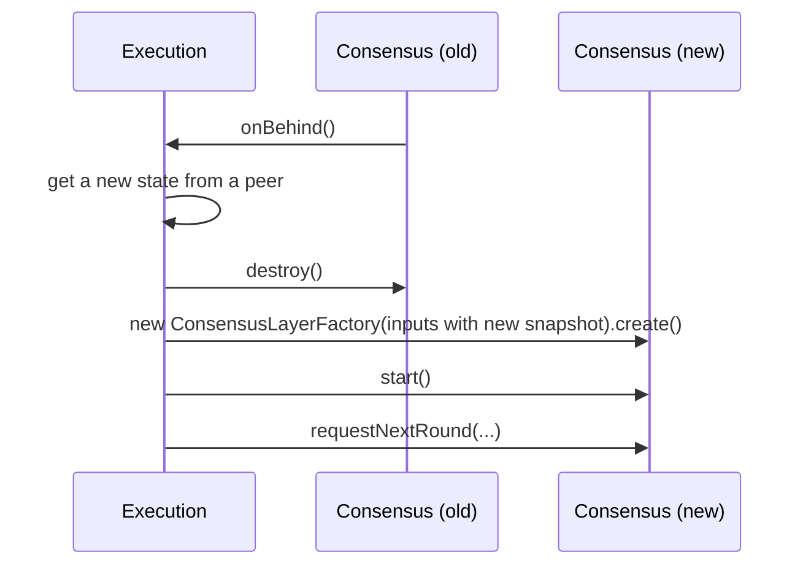
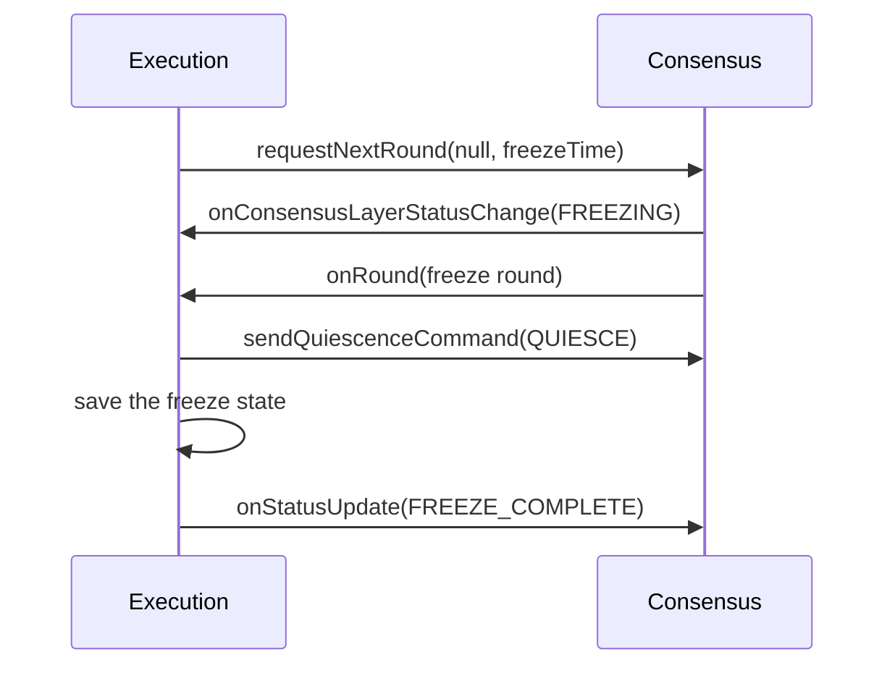

# Consensus Layer API

## 1. Purpose

This document introduces a proposed API between the execution layer and the consensus layer. We are asking the execution team to review it and give feedback.

The API is made up of four types:

| Type | Role |
| --- | --- |
| `ConsensusLayerFactory` | Creates a `ConsensusLayer` instance. |
| `ConsensusLayerInputs` | Everything the consensus layer needs to be created. |
| `ConsensusLayer` | Methods the execution layer calls on consensus. |
| `ExecutionLayerCallbacks` | Methods the consensus layer calls on execution. |

The source for these types, and the model types they use (`Round`, `Event`, `TimestampedTransaction`, `ConsensusLayerStatus`, `QuiescenceCommand`, `ConsensusLayerRosterInputs`), is provided with this document. The javadocs on those types are the reference for the behavior of each method. This document does not repeat them. It explains how the parts fit together and what changes for the execution layer.

A goal of the proof of concept was to define every input and interaction the consensus layer needs. There are no other dependencies between the two layers.

For the full architecture and its reasoning, see [Consensus-Layer.md](Consensus-Layer.md). Reading it is optional.

## 2. What Is Changing

Today, the boundary between the layers is wide. The execution layer gives `PlatformBuilder` an `ExecutionLayer`, a `ConsensusStateEventHandler`, a `StateLifecycleManager`, and optional listeners. The platform then manages state, reconnect, and the node lifecycle, and calls into the execution layer with `State` objects.

In the new API, the consensus layer is a library. The execution layer creates it, drives it, and destroys it. The consensus layer never sees the state.

| Responsibility | Today | New API                                                                                                              |
| --- | --- |----------------------------------------------------------------------------------------------------------------------|
| Creating the layer | `PlatformBuilder` builds the platform. | Execution builds the consensus layer with `ConsensusLayerFactory`.                                                   |
| State | The platform holds, copies, hashes, signs, and saves the state. | Execution owns the state. Consensus only needs a `ConsensusSnapshot`, Rosters, and `runningEventHashOverride`.        |
| Producing rounds | The platform produces rounds as fast as it can. | Execution requests each round. Consensus produces only the rounds that are requested.                                |
| Reconnect | The platform detects the need, runs reconnect, and swaps the state. | Consensus reports that it is behind. Execution drives the reconnect and replaces the consensus layer with a new one. |
| Freeze time | The platform reads the freeze time from the state. | Execution passes the freeze time (if applicable) with each round request.                                            |
| State signature transactions | Passed between the layers, collected by the platform. | Not part of the API. Signature collection is done by the Execution Layer.                                            |
| ISS detection | Done by the platform | Done by the Execution Layer.                                                                                         |
| Status | `PlatformStatus` includes `RECONNECT_COMPLETE`, a reconnect status. | `ConsensusLayerStatus` covers only the consensus layer. It adds `IDLE` for when no round is requested.               |
| Pre-handle before Handle contract | Enforced by the platform. | Enforced by the Execution Layer, enabled by the API.                                                                 |

## 3. API at a Glance

There will be two new modules: one of the new API classes `ConsensusLayer` and `ConsensusLayerFactory` and another for the model classes required to interact with the API named `consensus-main-model` .

## 4. Creating the Layer and Requesting Rounds

**Creating the layer.** The execution layer fills in a `ConsensusLayerInputs`, passes it to a `ConsensusLayerFactory`, calls `create()`, and then calls `start()` on the result. If the inputs contain no `ConsensusSnapshot`, the consensus layer starts a new hashgraph from genesis. Otherwise, it continues from the snapshot.

**Requesting rounds.** Each call to `requestNextRound` produces exactly one round, which is delivered to `onRound`. The consensus layer does not work ahead. If the execution layer wants a buffer of rounds, it requests more than one round in advance. This is how the execution layer controls how fast the node runs.

## 5. Scenarios

### 5.1 Genesis

### 5.2 Restart From a Saved State

The execution layer loads its saved state and creates the consensus layer with the snapshot from that state. It must also provide the roster history for the non-ancient rounds of that snapshot.

On `start()`, the consensus layer reads events from its pre-consensus event stream (PCES) on disk. The execution layer requests rounds as usual. Rounds and events that come from this replay are marked with `isPcesRound()` and `isPcesEvent()`. After the replay, the consensus layer connects to its peers and continues normally.

### 5.3 Reconnect

This flow is temporary. Reconnect will be replaced with block node reconnect later.

The old instance cannot be reused after `destroy()`. A new instance is created from the snapshot in the new state.

### 5.4 Freeze

After the freeze round, the consensus layer ignores new round requests. The execution layer must send `QUIESCE` or call `destroy()` soon after the freeze round. If it does not, the node keeps creating events, and those events use memory and disk space that are never released.

### 5.5 Shutdown

The execution layer calls `destroy()`. The method releases all resources, closes all connections, and returns when this is complete.

## 6. What the Execution Layer Must Do

| Obligation | If it is not done |
| --- | --- |
| Save `Round.getConsensusSnapshot()` with each saved state. | The node cannot restart from that state. |
| Call `oldestRestartableSnapshot()` when old states are deleted. | PCES files are never deleted, and disk use grows without limit. |
| Send `QUIESCE` or call `destroy()` after the freeze round. | Memory and disk use grow without limit. |
| Return transactions that follow the `TransactionLimits` in the inputs. | The event is invalid, and its transactions are lost. |
| Call `signalPrehandleCompletion()` after pre-handle, and `awaitPrehandleCompletion()` before handle. | An event may be handled before it is pre-handled. |
| Return quickly from every callback. | The consensus layer is delayed. |
| Request rounds on a regular basis. | The node falls behind and requires a reconnect. Gossip is limited to a narrow section of the hashgraph based on the latest round produced. |

## 7. Temporary Parts of the API

These parts of the API exist only to support the current system. They will be removed.

| Item | Removed when |
| --- | --- |
| `ConsensusLayer.setReconnectPeerProtocolFactory()` | Reconnect state transfer moves to the block node. |
| `ConsensusLayer.onStatusUpdate()` | The execution layer has a metric that represents the status of the entire consensus node. |
| `ConsensusLayerInputs.runningEventHashOverride` | The consensus event stream is retired. |
| `ConsensusLayerInputs.consensusEventStreamName` | The consensus event stream is retired. |
| `Round.getLastEventRunningHash()` | The consensus event stream is retired. |

The `newRoster` parameter of `requestNextRound` is part of the API but is not implemented yet. It will be implemented as part of the dynamic address book work.

## 8. Moving to the New API: The Adapter

The execution layer does not need to move to the new API right away.

An adapter will be implemented to keep the current `PlatformBuilder` boundary working without changes. Inside, it creates the new `ConsensusLayer` and implements `ExecutionLayerCallbacks` on behalf of the current application. It translates between the new API and the current interfaces. The proof of concept branch includes a working version of such an adapter.

This allows:

- The consensus team to move to the new architecture now.
- The execution team to move to the new API when it is ready.

When the execution layer uses the new API directly, the adapter will be adopted by the execution layer step by step.